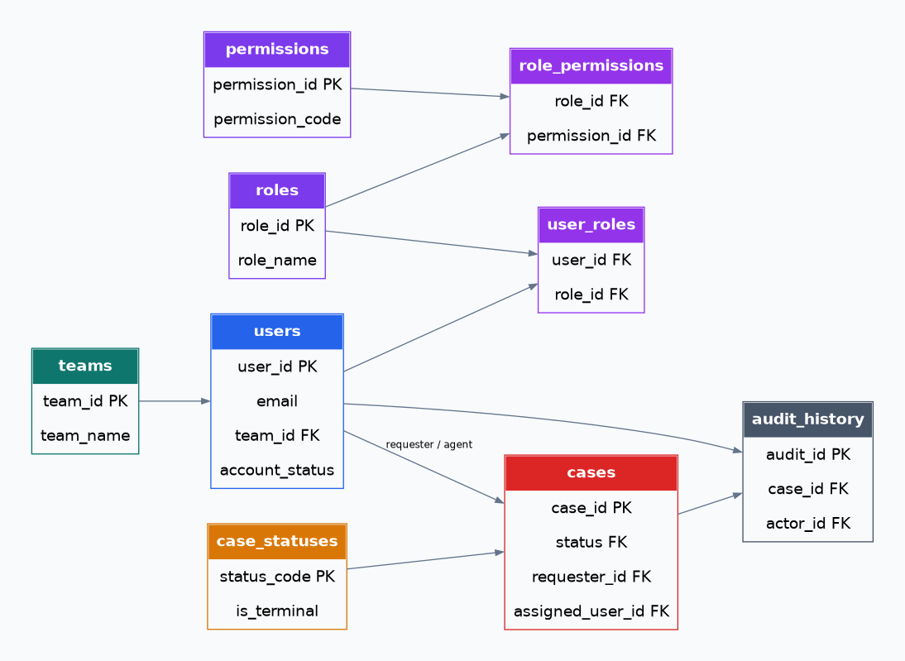
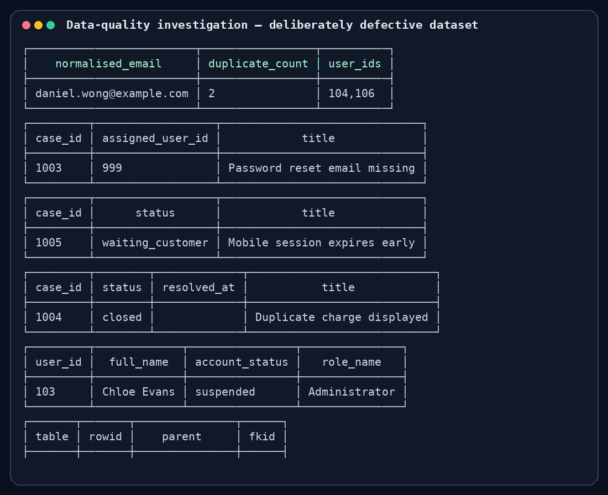
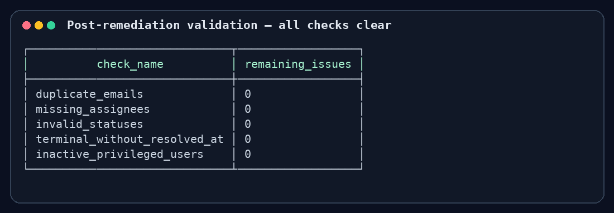

# SQL Application Support Investigation Lab

A compact, reproducible SQLite portfolio project demonstrating how an application-support analyst investigates user access, permissions, helpdesk cases, audit history and data-integrity incidents.



## Why this project

This lab converts SQL fundamentals into practical support evidence. It uses a deliberately defective service-management dataset, read-only diagnostics, five ticket investigations, guarded remediation scripts and automated post-change checks.

## Demonstrated skills

- SQL `SELECT`, filtering, `INNER JOIN`, `LEFT JOIN`, aggregation, `GROUP BY`, `HAVING`, scalar subqueries and `EXISTS`
- User-role-permission investigation
- Case queues and chronological audit tracing
- Duplicate, orphan, invalid-status and incomplete-workflow diagnosis
- Transactional, narrowly scoped and repeatable remediation
- Acceptance checks with SQLite foreign-key auditing
- Clear incident documentation from symptom to prevention

## Seeded incidents

| Ticket | Problem | Diagnostic technique | Resolution |
|---|---|---|---|
| [TICKET-001](tickets/TICKET-001-duplicate-user.md) | Duplicate user after email normalisation | `LOWER`, `TRIM`, `GROUP BY`, `HAVING` | Repoint dependencies; remove duplicate |
| [TICKET-002](tickets/TICKET-002-missing-assignee.md) | Case references absent agent | `LEFT JOIN ... IS NULL` | Assign valid active agent |
| [TICKET-003](tickets/TICKET-003-invalid-status.md) | Obsolete integration status | Reference-table anti-join | Map value to `pending` |
| [TICKET-004](tickets/TICKET-004-missing-resolution-time.md) | Closed case lacks timestamp | Terminal-status join and audit lookup | Derive time from close event |
| [TICKET-005](tickets/TICKET-005-suspended-admin.md) | Suspended administrator retains access | Multi-table permission join | Revoke exact role assignment |

## Quick start

### Requirements

- SQLite 3
- Bash (macOS, Linux, Git Bash or WSL)
- `make` is optional

### Run the workflow

```bash
# 1. Build a fresh database containing five deliberate defects
./scripts/build.sh

# 2. Run read-only investigations
./scripts/investigate.sh

# 3. Apply guarded fixes and show acceptance results
./scripts/remediate.sh

# 4. Rebuild, remediate and assert all checks automatically
./scripts/test.sh
```

Or use `make build`, `make investigate`, `make remediate`, and `make test`.

Expected automated result:

```text
PASS: all five seeded defects were remediated and integrity checks are clean.
```

## Investigation evidence

The checks intentionally expose duplicate identities, an orphaned assignee, an undefined workflow status, a closed case without `resolved_at`, and privileged access retained by a suspended user.



After remediation, each acceptance check reports zero remaining issues; the empty output following the table is the expected successful result from `PRAGMA foreign_key_check`.



Full machine-generated outputs are retained in [`expected-results/`](expected-results/README.md).

## Project map

```text
sql-application-support-lab/
├── schema.sql                     # Tables, constraints and indexes
├── sample_data.sql                # Reproducible data with deliberate defects
├── queries/                       # Read-only support investigations
├── remediation/                   # Transactional, guarded fixes
├── tickets/                       # Five end-to-end incident records
├── tests/validate_lab.sql         # Post-change acceptance checks
├── expected-results/              # Captured, verified CLI results
├── docs/schema.md                 # ER model and data dictionary
├── docs/screenshots/              # Schema and terminal evidence
└── scripts/                       # Build, investigate, remediate and test
```

## Safety approach

1. Reproduce against a local database, never a production copy.
2. Investigate with read-only queries before changing anything.
3. Identify exact rows and document evidence.
4. Use `BEGIN IMMEDIATE` plus guarded `WHERE` clauses.
5. Change dependent data in a safe order.
6. Validate business rules and referential integrity afterwards.
7. In production, add backup, peer review, change approval and rollback steps.

## Useful queries

Start with:

- [`01_users_and_permissions.sql`](queries/01_users_and_permissions.sql) for effective access
- [`02_cases_and_audit.sql`](queries/02_cases_and_audit.sql) for queues, history and workload
- [`03_data_quality_checks.sql`](queries/03_data_quality_checks.sql) for all seeded defects
- [`04_safe_query_examples.sql`](queries/04_safe_query_examples.sql) for portfolio-ready query patterns

## Design note

SQLite foreign-key enforcement is enabled in the schema and remediation paths. It is disabled only during controlled sample loading so the lab can reproduce historical bad data that a support analyst might inherit. The finished validation expects no foreign-key violations.

## Portfolio talking point

> I built a reproducible SQLite application-support lab around users, RBAC permissions, cases and audit events. I seeded five realistic defects, diagnosed them using joins, aggregation and subqueries, wrote guarded transactional fixes, and automated integrity validation so every investigation can be demonstrated from a clean build.

## License

MIT
