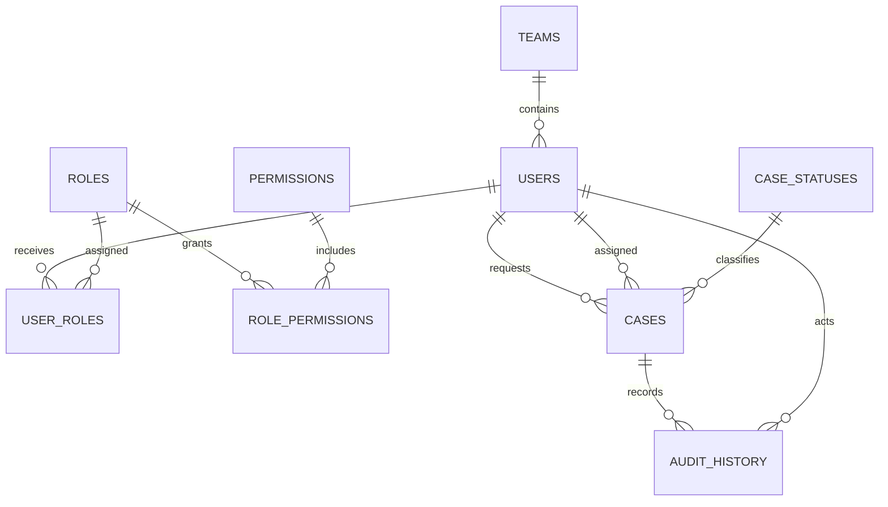

# Database schema

## Table purpose

| Table | Purpose |
|---|---|
| `teams` | Support and business teams |
| `users` | Requesters, agents and administrators |
| `roles`, `permissions` | Access-control catalogue |
| `user_roles`, `role_permissions` | Many-to-many access mappings |
| `case_statuses` | Controlled workflow values |
| `cases` | Helpdesk/service-management records |
| `audit_history` | Chronological case actions |

The schema defines foreign keys, checks and performance-oriented indexes. `sample_data.sql` temporarily disables foreign-key enforcement solely to seed two realistic legacy-import violations for investigation.
